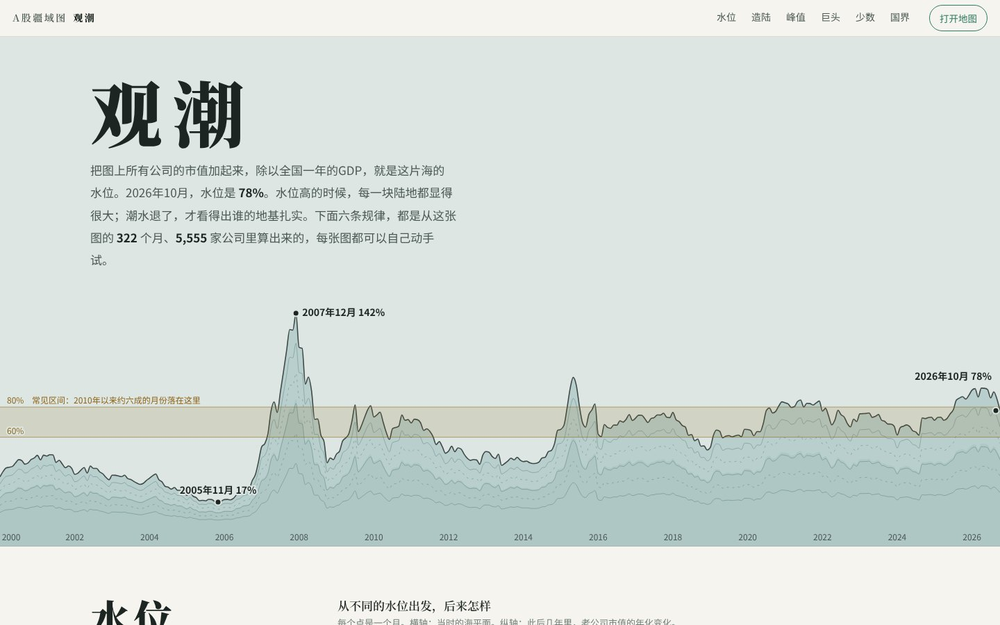
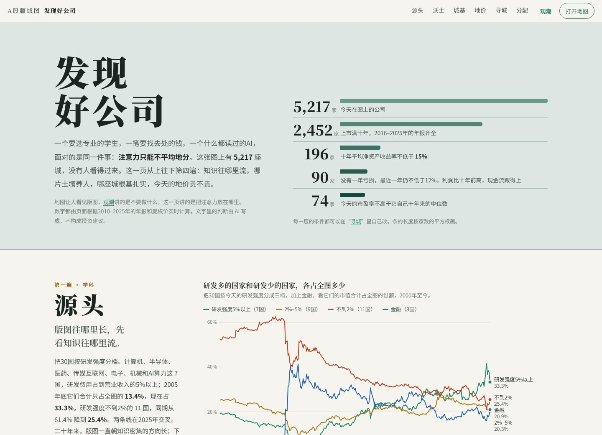
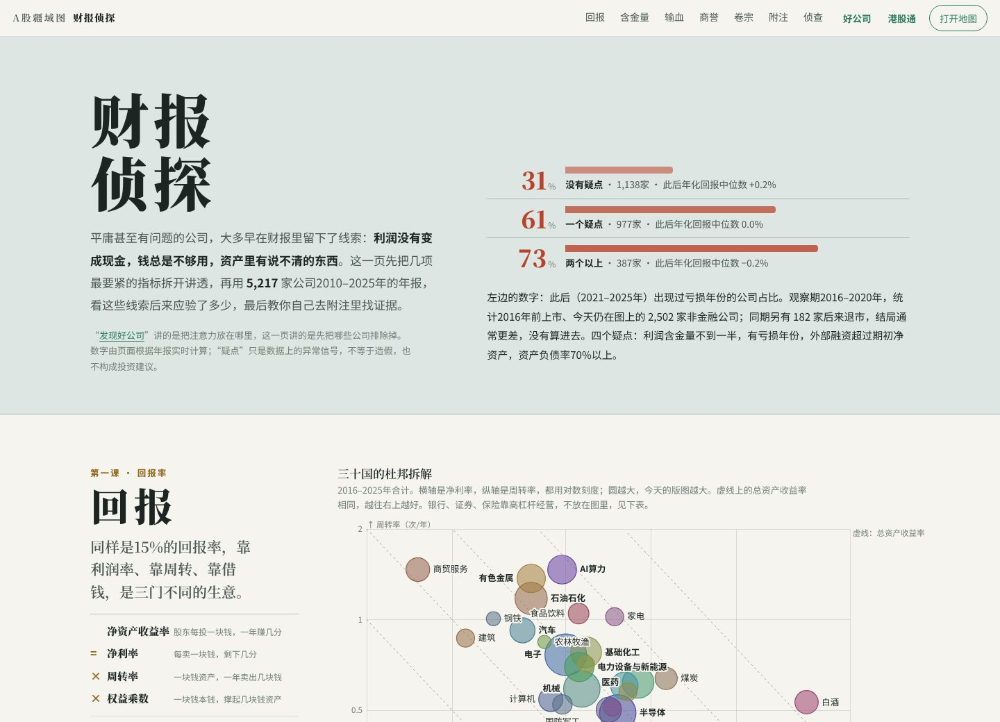
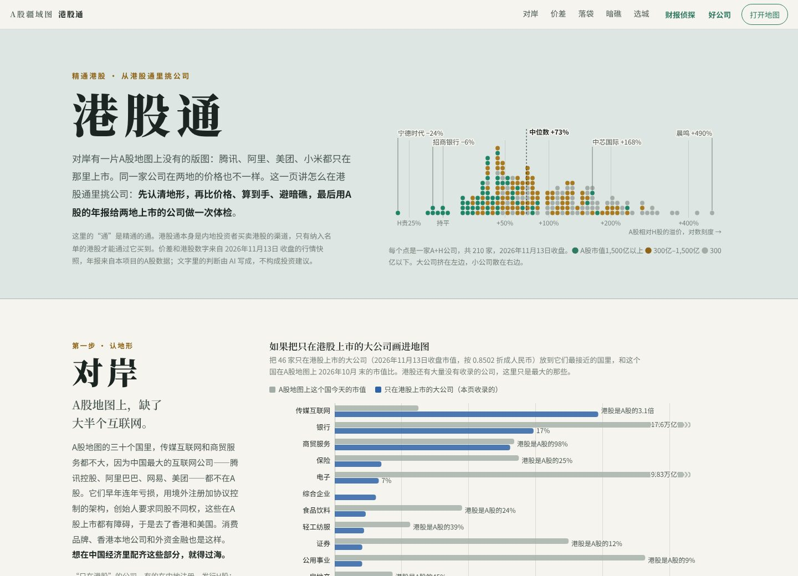
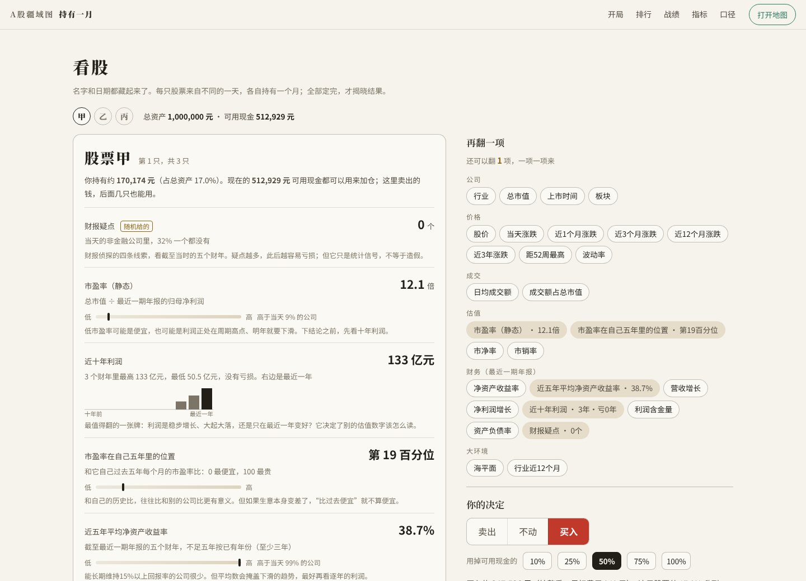
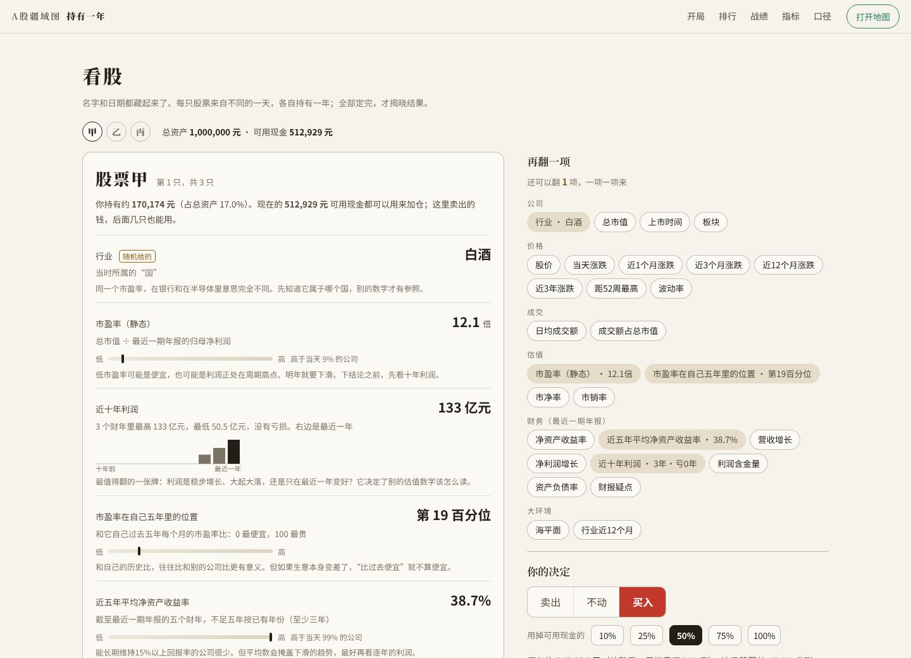
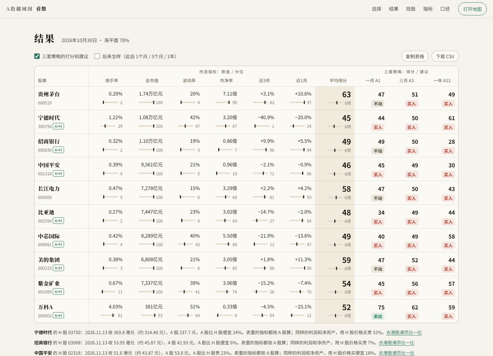

# A股疆域图

一张会动的A股地图：每个行业是一个国家，每家公司是一座城，城的面积就是公司的市值。拖动时间轴，看2000年到2026年沪深两市的行业版图怎么扩张、收缩。

**在线体验 · 地图：** https://wanglu2016.github.io/agu-jiangyu/
**在线体验 · 观潮（从地图里读出的六条规律）：** https://wanglu2016.github.io/agu-jiangyu/guanchao.html
**在线体验 · 发现好公司（从学科、产业、公司、价格筛四遍）：** https://wanglu2016.github.io/agu-jiangyu/faxian.html
**在线体验 · 财报侦探（财务指标与财报里的线索）：** https://wanglu2016.github.io/agu-jiangyu/zhencha.html
**在线体验 · 港股通（从港股通里挑公司）：** https://wanglu2016.github.io/agu-jiangyu/ganggu.html
**在线体验 · 持有一月（用真实历史练眼力的小游戏）：** https://wanglu2016.github.io/agu-jiangyu/chiyou.html
**在线体验 · 持有三月：** https://wanglu2016.github.io/agu-jiangyu/sanyue.html
**在线体验 · 持有一年：** https://wanglu2016.github.io/agu-jiangyu/yinian.html
**在线体验 · 看数（每只股票的28项指标与分位）：** https://wanglu2016.github.io/agu-jiangyu/kanshu.html
**使用讲解视频（4分38秒）：** https://wanglu2016.github.io/agu-jiangyu/video.html （录制于加入候选国、海平面和后面五个页面之前）
















## 能做什么

- **看版图：** 30个行业各有固定颜色，国名下面是该行业占全图的份额；大公司单独成城，标着名字和市值，浅色小块是其余较小的公司。滚轮或双指可以放大。
- **拖动时间轴：** 2000年1月到2026年10月，每月一帧，共322个月。时间轴本身是一张按行业分层的年表，小三角标着大事；可以播放、调速。
- **此时：** 10段时代解说随年月切换，并列出当月市值前十的公司。
- **查一家公司：** 悬停看市值、全图排名和占比；点开看历年市值曲线和它先后属于哪个行业（例如中际旭创：机械 → 通信 → AI算力）。
- **搜索：** 名称、曾用名、代码都能搜，已退市的公司也在。
- **幸存者偏差：** 打开“标出日后退市的公司”，后来退市或被合并的公司会圈上红色虚线，并算出它们当时占全图多少。
- **诸国：** 30个行业各自的份额曲线，黑点标出每一国版图最大的时候。点开一国，可以看到它“最大两年后还剩多少”。
- **候选国：** 创新药、机器人、储能三个正在形成的行业，从2023年1月起用虚线国界画在地图上，公司从原来的国里划出；可以在“诸国”里一键隐去，回到原来的30国。
- **海平面：** 全图市值 ÷ 近一年GDP，也就是这片海的水位。地图标题、“此时”面板和时间轴（点“看海平面”）上都能看到，并给出历史上从相近水位出发后三年的情况。
- **时光机：** “此时”面板会告诉你，当月市值最大的十家公司到今天变成了多少，同期整张图又变成了多少。
- **年报：** 点开一家公司，“详情”里有它2010–2025年逐年的净资产收益率、最近一年的利润和市盈率，并可跳到“发现好公司”看完整的财报小传、到“财报侦探”查它的疑点；两地上市的公司还会显示A股相对H股的溢价，可跳到“港股通”比一比。
- **资料与边界：** 数据来源、算法和不准的地方。

## 观潮：六条规律

[观潮](https://wanglu2016.github.io/agu-jiangyu/guanchao.html)是同一份数据的第二个页面。地图让人看见版图，观潮把版图背后的规律一条一条算出来，每张图都可以拖动、切换。下面的数字按2026年10月的数据计算，页面上是实时算的。

| 章 | 说的是什么 | 图上的一个数字 |
|---|---|---|
| 水位 | 海平面越高，此后几年越难赚钱 | 2000年以来最低17%（2005年11月），最高142%（2007年12月），现在78% |
| 造陆 | 版图扩大多半靠新公司上市，而不是老公司涨价 | 全图市值是2000年初的36倍，名义GDP是16倍，只算老公司的市值是4.8倍 |
| 峰值 | 一个行业版图最大的时候，往往就是它最贵的时候 | 19个行业到顶两年后，份额平均只剩峰值的68% |
| 巨头 | 当年市值最大的十家公司，后来多半走得比整张图慢 | 2007年10月的前十占全图46%，到今天市值合计是当时的0.89倍，整张图是3.25倍 |
| 少数 | 多数公司原地踏步，少数公司带来了几乎全部增量 | 2010年底至今，中位数公司的市值只变成1.38倍，34%的公司比当时还小 |
| 国界 | 国界是人画的，新的行业正在形成 | 三个候选国、低空观察名单，以及科技行业内部六个环节的份额变化 |

这些都是历史统计，不代表未来，**不构成投资建议**。

## 发现好公司：从上往下筛四遍

[发现好公司](https://wanglu2016.github.io/agu-jiangyu/faxian.html)是第三个页面。地图让人看见版图，观潮讲的是不要做什么，这一页讲的是把注意力放在哪里：一个要选专业的学生、一笔要找去处的钱、一个什么都读过的AI，都只能把注意力不平均地分。它在市值之外加了两份数据：每家公司2010–2025年的年报（营收、归母净利润、归母净资产、经营现金流），和含分红的复权回报。下面的数字按2026年10月的数据计算，页面上是实时算的。

| 章 | 筛的是什么 | 图上的一个数字 |
|---|---|---|
| 源头（学科） | 版图往哪里长，先看知识往哪里流 | 研发强度5%以上的7个国，2005年底合计占全图13%，现在占33%；另有七条前沿和一片“远方”的卡片 |
| 沃土（产业） | 研发最多的土壤，不一定最肥 | 2016–2025年合计的净资产收益率：白酒26%、家电20%，计算机3%、半导体6%；全图从2010年的16%降到2025年的8% |
| 城基（公司） | 时间一长，股票的回报就是这门生意的回报 | 2015年底买入：此后十年净资产收益率超过20%的公司，持股回报的中位数是2.34倍；不到5%的公司占一半，中位数是0.44倍 |
| 地价（价格） | 好公司买贵了，一样不赚钱 | 2020年底“回报率15%以上、市盈率40倍以上”的88家公司，持有五年的年化回报中位数是−6.1% |
| 寻城（筛选） | 把四道筛子叠起来，自己改条件 | 5,217家 → 上市满十年且年报齐全2,452家 → 十年平均净资产收益率不低于15%的196家 → 默认条件下通过74家 |
| 分配（注意力） | 平均分配注意力，大半是浪费 | 白酒只有19家公司，占家数的0.4%，却出了5.6%的“十年一直赚钱”的公司 |

“寻城”里可以拖动条件、按国家或前沿筛选、直接搜一家公司；点一家公司会出现它的财报小传（逐年的净资产收益率、利润与现金流、年末市盈率）和一份体检清单，并可以跳回地图上看这座城。

前沿卡片里的判断、“AI的注意力”和“三类地”的分法是 AI（Claude）写的，会错，也会过时；筛出来的名单只是“过去十年像一家好公司、今天的价格不比它自己的历史贵”，是研究的起点，**不构成投资建议**。

## 财报侦探：先把哪些公司排除掉

[财报侦探](https://wanglu2016.github.io/agu-jiangyu/zhencha.html)是第四个页面。“发现好公司”讲把注意力放在哪里，这一页讲先排除谁：平庸甚至有问题的公司，大多早在财报里留下了线索。它用同一份2010–2025年报，先把几项最要紧的指标拆开讲透，再看这些线索后来应验了多少，最后教你去附注里找证据。下面的数字按2026年10月的数据计算，页面上是实时算的。

| 章 | 讲的是什么 | 图上的一个数字 |
|---|---|---|
| 页首 | 疑点越多，后来越容易亏损 | 2016–2020年没有疑点的公司，此后31%出现过亏损；一个疑点61%；两个以上73% |
| 回报 | 杜邦拆解：利润率、周转、杠杆 | 白酒的回报几乎全靠35%的净利率；2011–2015年的高回报公司里，周转型十年后还有35%守在15%以上，杠杆型只有21% |
| 含金量 | 利润是观点，现金是事实 | 五年年年盈利、经营现金流合计却为负的89家公司，此后55%出现过亏损，回报率从6.5%掉到0.9% |
| 输血 | 给股东分钱，还是向股东要钱 | 2010–2025年合计利润54.6万亿，扣掉净资产的增加，净回到股东手里的只有9%；白酒、煤炭把一半左右还给了股东，军工、半导体的净资产涨得比利润还多 |
| 商誉 | 并购买来的利润 | 今天有136家公司的商誉超过净资产的30%，23家超过净资产本身 |
| 卷宗 | 六起大案的线索 | 康美药业、康得新、獐子岛、乐视网、东旭光电、天神娱乐：疑点、真相，和数据里的痕迹 |
| 附注 | 十六条线索，去哪里查 | 存贷双高、应收账款、存货、在建工程、研发资本化、商誉、非经常性损益、审计意见…… |
| 侦查 | 给任何一家公司点五盏灯 | 4,637家非金融公司里，2,090家一盏都没亮，114家同时亮起三盏以上 |

“疑点”和“灯”只是统计信号，不等于造假，也不是对任何公司的指控；“此后的命运”只统计今天还在图上的公司，退市的大多没有年报数据，所以疑点组的结果偏乐观。

## 港股通：从港股通里挑公司

[港股通](https://wanglu2016.github.io/agu-jiangyu/ganggu.html)是第五个页面，“通”是精通的通。港股通本身是内地投资者买卖港股的渠道，只有纳入名单的港股才能通过它买到。这一页讲怎么在港股通里挑公司：先认清地形，再比价格、算到手、避暗礁，最后用A股的年报给两地上市的公司做一次体检。港股数字来自2026年11月13日收盘的快照。

| 章 | 讲的是什么 | 图上的一个数字 |
|---|---|---|
| 对岸 | A股地图上缺了大半个互联网 | 腾讯、网易、快手、百度等合计3.93万亿元，是A股地图上传媒互联网的3.1倍；港股通的纳入规则 |
| 价差 | 同一家公司，两个价格 | 210对A+H公司，A股溢价中位数73%；市值200亿以下的中位数160%，1,500亿以上只有33%；只有6家的H股比A股还贵 |
| 落袋 | 股息率要先打个八折 | 港股通股息扣20%（红筹约28%），A股持有一年以上免税；A比H贵25%以上，收息才该选H股；附计算器 |
| 暗礁 | A股没有的规则风险 | 没有涨跌停、流动性折价、老千股、停牌18个月可除牌、第二上市不在通…… |
| 选城 | 用A股年报判断生意，用H股价格决定买哪边 | 两地上市的公司按回报率、H股市盈率、价差筛选；46家只在港股上市的大公司按类别写了该看什么 |

港股快照只收录了两百多对A+H公司和四十多家港股大公司，不是港股通的全部名单；数字会过时，**不构成投资建议**。

## 持有一月 · 持有三月 · 持有一年：用真实历史练眼力

[持有一月](https://wanglu2016.github.io/agu-jiangyu/chiyou.html)是第六个页面，一个小游戏。前五页是课本，这一页是练习册：看到行情软件上的一个数字，能不能想到它在什么情况下会骗人，下一眼该看哪一行。

| 步骤 | 做什么 |
|---|---|
| 开局 | 一个100万元的账户：约50万元按整手平均买成1–5只股票（只数自己选，可以只从当时市值前300名里抽），其余是可用现金。每只股票各自来自2013年5月到2026年9月里随机的一天，名字和日期都藏起来 |
| 翻牌 | 每只股票先随机亮出一项指标，再从28项里自己翻最多5项：行业、市值、股价、近期涨跌、波动、成交、市盈率（静态）、市盈率在自己五年里的位置、市净率、净资产收益率、近十年利润、利润含金量、财报疑点、海平面……翻开后显示它在当天全部A股里的位置，和“这个数字怎么会骗人”的提示 |
| 交易 | 卖出按持仓的比例，买入按当时全部可用现金的比例，都按整手、在那天收盘价成交，扣0.1%费用。前面卖出的钱后面能用：卖光前四只，最后一只几乎可以满仓。涨停封板的买不进，跌停封板的卖不出 |
| 揭晓 | 每只股票各自持有一个月，盈亏拆成“原来的持仓”和“你的操作”两部分，每只和它自己同期的大盘比（这样输赢不取决于抽到哪个月）；公布名字、日期、当月全部A股的涨跌分布、每天的走势和当时的28项指标；再往后看一年、三年 |
| 排行 | 每局的选择和结果匿名记到排行榜服务器，服务器按题库答案重算后，按“你的操作带来”在所有局里排名；进入前100名可以选择晒战绩、留个昵称 |
| 战绩 | 自己这台设备上的统计：你加仓、不动、减仓的股票，一个月、一年、三年后各比同期大盘多涨多少；你最常翻哪几张牌 |

为什么偏偏只给一个月：在题库里，“五年平均回报率15%以上、没有疑点”的公司，一个月后跑赢大盘的比例是46%，“财报疑点两个以上”的公司是47%，几乎分不出高下；三年后是40%对36%，比大盘多涨的中位数是−13对−20个百分点（页面上是实时算的）。一局的输赢多半是运气，要看的是很多局以后，你的操作一年、三年后还站不站得住。

题库共161个决策日、7,225道题、3,174家公司（含后来退市的）。指标只用当天能看到的数据，回报含分红；颜色按行情软件的习惯，红涨绿跌。“这个数字怎么会骗人”的提示由 AI（Claude）编写，**不构成投资建议**。

### 持有三月、持有一年

[持有三月](https://wanglu2016.github.io/agu-jiangyu/sanyue.html)和[持有一年](https://wanglu2016.github.io/agu-jiangyu/yinian.html)是同一个游戏的两个兄弟，玩法、账户、翻牌和交易规则完全一样，只是每只股票持有三个月、一年才揭晓。每个游戏有自己的排行榜和自己的战绩，互不混排。

| | 持有一月 | 持有三月 | 持有一年 |
|---|---|---|---|
| 决策日 | 2013年5月–2026年9月，161个 | 2013年5月–2026年7月，159个 | 2013年5月–2025年10月，150个 |
| 题数 | 7,225道，3,174家公司 | 7,135道，3,143家公司 | 6,731道，3,027家公司 |
| 揭晓时的走势图 | 当月每个交易日 | 三个月里14个等距的交易日 | 一年里每个月末 |
| 再往后看 | 一年、三年 | 一年、三年 | 三年 |

三个游戏用同一份题库，决策日越晚的题，越要等得久才有答案，所以持有越久，能抽的题越少。持有得越久，生意的差别越有机会显出来，但也没有想象中快：题库里“好公司”和“满身疑点”的公司，三个月后跑赢大盘的比例是42%对43%，一年后43%对44%，三年后才拉开到40%对36%（页面上是实时算的）。

### 开通排行榜

GitHub Pages 只能放静态网页，记录所有玩家的对局需要一个数据库。本项目用 [Supabase](https://supabase.com)（有免费额度）：

1. 用 GitHub 账号登录 Supabase，新建一个项目（Region 选新加坡或东京，离国内近）。
2. 打开项目的 **SQL Editor**，把 [`tools/chiyou-supabase.sql`](tools/chiyou-supabase.sql) 的全部内容粘贴进去，点 **Run**。它会建两张表（题库答案、对局记录）和三个函数（提交一局、晒战绩、读排行榜），可以重复运行。三个游戏共用这两张表：答案表里有一个月、三个月、一年三列回报，对局表的 `game` 列（1、3、12）区分是哪个游戏，排行榜各排各的。
3. 打开 **Project Settings → API Keys**，把 Project URL 和 Publishable key（`sb_publishable_…`，旧项目是 anon public key）填进 [`assets/chiyou-config.js`](assets/chiyou-config.js)。

本项目已经填好（项目 game-leaderboard，新加坡）。没填的时候游戏照常能玩，只是不上传、不排名。这个公开密钥本来就是给网页用的：两张表都开了行级安全且不给任何权限，网页只能调用那三个函数；提交时服务器不相信网页算的盈亏，而是按题库答案重新计算，再按“你的操作带来”排名。所有对局都可以在 Supabase 后台的 `cy_rounds` 表里查看、导出。

## 看数：每只股票的28项指标与分位

[看数](https://wanglu2016.github.io/agu-jiangyu/kanshu.html)是一张随取随用的对照表：游戏里藏起名字的那 28 项指标，这里对每一只A股、每一个月末都能翻开看，便于按自己的规则算分。

| 功能 | 做什么 |
|---|---|
| 选股票 | 最多 10 只，按代码、名称、曾用名或拼音首字母搜（如 600519、茅台、gzmt），含已退市的公司；A+H 公司也能用 H 股代码或名称找到 |
| 选日期 | 2013年5月到2026年10月的任一个月末；也可以不选日期，看走势 |
| 勾指标 | 28 项任选，有“一月策略 A1”“三月策略 A3”“一年策略 A12”“六项都看”几个快捷组合；每项可以“反过来”（用 100 − 分位） |
| 结果表 | 每只股票每项的数值和分位（高于当天多少比例的合格A股），以及平均得分；可排序、展开看全部 28 项，可复制或下载 CSV |
| 三套策略 | 按回测得出的三套规则给每只股票打分，给出买入、不动或卖出的建议（一月策略还看当天的海平面） |
| 后来怎样 | 可选：此后 1 个月、3 个月、1 年的涨跌（含分红）和同期大盘，用来回头检验 |
| 走势 | 不选日期时，每只股票一张小图，画出得分（或某一项的分位）在 162 个月里的起落，上方是同期海平面；点图上的某个月，切回那一天的表格 |
| 在全部A股里找 | 用同一组指标和方向，给某一天图上的全部公司打分，列出最低、最高的各 20 家，可按行业、市值前 300 筛选，一键加入对照表 |

数值和分位的算法与三个小游戏完全相同，游戏题库里的 7,225 道题逐项核对过。地址栏会记住选择，收藏或发出链接，打开就是同一张表；地图上点开一家公司、游戏揭晓的卡片里，都有直达它这一天看数的链接。港股没有逐月历史数据：A+H 公司的指标来自它的A股，另附 2026年11月13日的 H 股股价和价差；只在港股上市的公司只显示那一天的快照，不能打分。**不构成投资建议**。

## 下载

- **离线版网页（约54 MB，其中看数的数据约45 MB）：** [agu-jiangyu-site.zip](https://github.com/wanglu2016/agu-jiangyu/raw/main/download/agu-jiangyu-site.zip)。解压后双击 `index.html`（地图）、`guanchao.html`（观潮）、`faxian.html`（发现好公司）、`zhencha.html`（财报侦探）、`ganggu.html`（港股通）、`chiyou.html`（持有一月）、`sanyue.html`（持有三月）、`yinian.html`（持有一年）或 `kanshu.html`（看数）即可使用，不需要安装任何软件；三个小游戏的排行榜需要联网。
- **讲解视频（46 MB）：** [agu-jiangyu-guide.mp4](https://github.com/wanglu2016/agu-jiangyu/raw/main/video/agu-jiangyu-guide.mp4)，也可以在[视频页](https://wanglu2016.github.io/agu-jiangyu/video.html)点“下载视频”。
- **全部源代码：** 页面右上角绿色的 **Code → Download ZIP**。

需要较新的 Chrome、Edge、Safari 或 Firefox。手机也可以使用。

## 读图须知

- **口径：** 市值 = 月末收盘价 × 总股本。总股本按行情软件的通行口径，包含H股等境外股份并按A股价格折算，所以工商银行、中国石油这类A+H公司的版图偏大，“本图合计”通常比交易所公布的A股市值高一成左右。
- **估算：** 332家公司部分月份缺总股本，2010年以后用流通股本代替，2010年以前由成交额推算，图上画斜线。估算部分在2000年约占全图13%，2020年后不到1.5%。
- **行业：** 以证监会行业分类（2012年版）为基础合并成30个“国”；白酒、家电、半导体、AI算力（2023年1月起）是本项目按公司名单划出的。
- **候选国：** 创新药、机器人、储能的公司名单，以及“观潮”里的低空观察名单和科技环节分组，都是本项目按主营业务人工挑选的，边界有主观成分。峰值等统计一律按原来的30国计算。
- **海平面：** 全图合计市值 ÷ 近一年名义GDP（年度GDP在月份之间线性插值）。因为“本图合计”比交易所口径高一成左右，海平面也相应偏高。2015年起的GDP用第五次全国经济普查后的修订数；2014年及以前没有取到修订后的逐年数字，按2015年的修订幅度（+1.98%）接续，误差约1%；2026年按前三季度累计推算。“常见区间60%–80%”是经验区间，不是买卖信号。
- **老公司的市值（地价指数）：** 每个月只比较前后都在图上的公司，再逐月连乘。它不含分红，却包含增发和资产注入带来的市值，适合看长期方向，不宜当作收益率。
- **名称：** 多数公司用现名或退市前的最后名称，约三十家知名公司按改名时间显示旧名。
- **年报与净资产收益率：** “发现好公司”用的年报从2010年报到2025年报，所以“十年”指2016–2025财年；今天的市盈率是2026年10月末的市值除以2025年的归母净利润，没有用2026年的季报。净资产收益率 = 归母净利润 ÷ 年初与年末归母净资产的平均数。约一半公司的2025年现金流量表和研发费用没有取到；上市前的年份来自招股书，只画在公司小传里，不参与筛选。
- **持股回报：** 用复权收盘价计算，等于把分红再买成股票，只在每年12月末和最后一个月取值；它和“市值变成了几倍”不是一回事，后者还包含增发和资产注入。“城基”一章只统计今天还在图上的公司，回报率低的那几档实际更差。
- **学科与前沿：** 前沿的公司名单沿用候选国、观察名单和科技环节分组，学科与政策节点按公开报道的日期标注；高校专业数字来自教育部历年公布的本科专业备案和审批结果及公开报道，国家统计局的研发强度来自《2025年全国科技经费投入统计公报》。
- **财报侦探：** 疑点用的是观察期五年的年报：利润年年为正但经营现金流合计不到利润一半、有亏损年份、外部融资（期末净资产 − 期初净资产 − 五年利润）超过期初净资产、资产负债率70%以上（房地产除外）；“侦查”另加商誉超过净资产30%。杜邦拆解的总资产由归母净资产和资产负债率推算。净回馈 = 累计归母净利润 − 归母净资产的增加，约等于分红加回购减新募股本。卷宗案情来自证监会处罚决定、法院判决和公开报道。
- **持有一月：** 决策日是每个月最后一个交易日（2013年5月–2026年9月），每个决策日从“上市满一年、当天有交易”的公司里随机抽30家，再从当天市值前300名里抽15家；一局里的每只股票各自抽一个决策日。账户100万元，开局时每只买到最接近“50万 ÷ 只数”的整手数（至少一手）。1–4月用前年年报、5–12月用上一年年报；市盈率、市净率、市销率按最近一期年报算（静态），不是行情软件常用的滚动市盈率。回报用复权收盘价（含分红）；一个月后停牌的按停牌前价格计，后来退市的按最后一个交易日的价格计。“大盘”是当天图上全部公司按市值加权、买入后不再调整，不是沪深300。涨跌停按“收在最高（最低）价且涨跌幅达到板块限制”判断，没有识别ST股的5%限制。持有三月、持有一年的规则相同，只是回报算到三个月、十二个月后的月末；最后一道有答案的题分别来自2026年7月、2025年10月。
- **看数：** 每个月最后一个交易日（2013年5月–2026年10月）图上的全部公司；分位以当天“上市满一年、当天有交易”的公司为参照，不在参照里的（上市不满一年、当天停牌）也给出它在参照公司里的位置。上市时间、财报疑点、行业近12个月、近十年利润（按最近一年利润）的分位是看数新加的。平均得分只算有分位的指标，缺数据的按 50 计。
- **港股快照：** 2026年11月13日收盘，取自经济通网站的AH股表现、热炒概念股、港股通等页面（延迟报价），港元兑人民币按0.8502计算；脚本会用页面给出的溢价校验每一对的股价。A+H公司的年报用A股数据，A股市值是2026年10月末的，和快照差两周左右。港股大公司的类型、所属的国、是否在港股通等是人工标注的，“以名单为准”表示没有核实。
- **没有收录：** 1990–1999年（只有文字序章）、北京证券交易所、B股、2026年9月18日之后上市的6家新股。
- 单家公司个别月份的数值可能有误。本项目适合看行业大势，不宜当作个股数据来源，**不构成投资建议**。时代解说由 AI（Claude）编写，可能有错漏，欢迎在 Issues 中指出。

## 数据来源与许可

| 内容 | 来源 | 许可 |
|---|---|---|
| 每日价格（含已退市公司） | [chenditc/investment_data](https://github.com/chenditc/investment_data)（整合 Wind、Tushare 等来源的 qlib 数据包） | Apache-2.0 |
| 总市值、总股本 | [L2Wscorpio/ashare-market-data](https://github.com/L2Wscorpio/ashare-market-data) | 仓库未注明许可 |
| 三大报表（2010–2025年报）、研发费用 | [L2Wscorpio/ashare-market-data](https://github.com/L2Wscorpio/ashare-market-data) 的财务报表 | 仓库未注明许可 |
| 复权价（含分红的持股回报） | [chenditc/investment_data](https://github.com/chenditc/investment_data) | Apache-2.0 |
| “持有一月”的日线：复权收盘价、最高最低价、成交额、涨跌幅（2026年11月21日的数据包） | [chenditc/investment_data](https://github.com/chenditc/investment_data) | Apache-2.0 |
| 流通股本、逐月证监会行业、公司名称 | [noblechang/a-share-data](https://github.com/noblechang/a-share-data)（BaoStock 数据快照） | 仓库未注明许可，声明仅用于学习与研究 |
| 名义GDP、分行业研发强度 | 国家统计局年度与季度数据、《2025年全国科技经费投入统计公报》 | 公开统计数据 |
| 高校本科专业新增数 | 教育部历年“普通高等学校本科专业备案和审批结果”及公开报道 | 公开信息 |
| 港股快照（2026年11月13日） | [经济通 etnet.com.hk](https://www.etnet.com.hk/) 的“AH股表现”“热炒概念股”“港股通”页面，延迟报价 | 网站内容，仅供参考 |
| 南向资金、AH溢价指数、A+H公司数、港股通规则与税率 | Wind、恒生指数公司的数字经财联社、证券时报、21世纪经济报道等公开报道；沪深交易所、中国证监会公告 | 公开信息 |
| 财务造假案例 | 中国证监会行政处罚决定、法院判决、公司公告及公开报道 | 公开信息 |
| 绘图库 | [d3](https://github.com/d3/d3)、[d3-weighted-voronoi](https://github.com/Kcnarf/d3-weighted-voronoi)、[d3-voronoi-map](https://github.com/Kcnarf/d3-voronoi-map) | ISC、BSD-3-Clause（见 `assets/lib/`） |
| 字体 | Noto Serif SC / Noto Sans SC，按本项目用字裁剪 | SIL OFL 1.1（见 `assets/fonts/OFL.txt`） |

本项目自己的代码与文字可自由使用；所用数据请遵守各来源的条款。

## 项目结构

```
index.html          地图页面
guanchao.html       “观潮”页面：六条规律
faxian.html         “发现好公司”页面：学科、产业、公司、价格四遍筛选（脚本在 assets/faxian.js）
zhencha.html        “财报侦探”页面：财务指标与财报里的线索（脚本在 assets/zhencha.js）
ganggu.html         “港股通”页面：从港股通里挑公司（脚本在 assets/ganggu.js，港股快照在 assets/hk.js）
chiyou.html         “持有一月”小游戏（脚本在 assets/chiyou.js，题库在 assets/chiyou-data.js，排行榜服务器地址在 assets/chiyou-config.js）
sanyue.html         “持有三月”小游戏（和持有一月共用脚本与题库，另加 assets/chiyou-ext.js）
yinian.html         “持有一年”小游戏（同上）
kanshu.html         “看数”：每只股票的28项指标与分位（脚本在 assets/kanshu.js，数据在 assets/ks/）
video.html          讲解视频页
assets/             数据（data.js）、候选国版图（candidates.js）、GDP与名单（extra.js）、年报摘要与复权价（quality.js）、港股快照（hk.js）、“持有一月”题库（chiyou-data.js）和三个月、一年的答案（chiyou-ext.js）、看数的逐月指标（ks/：index.js 索引，s/ 每只股票一个文件，m/ 每个月一个文件）、绘图库、字体、图标与截图
download/           离线版压缩包
video/              讲解视频
tools/              数据处理脚本，见 tools/README.md
```

本地运行：直接双击 `index.html`、`guanchao.html`、`faxian.html`、`zhencha.html`、`ganggu.html`、`chiyou.html`、`sanyue.html`、`yinian.html` 或 `kanshu.html`；或在项目目录运行 `python3 -m http.server`，再打开 http://localhost:8000 。
