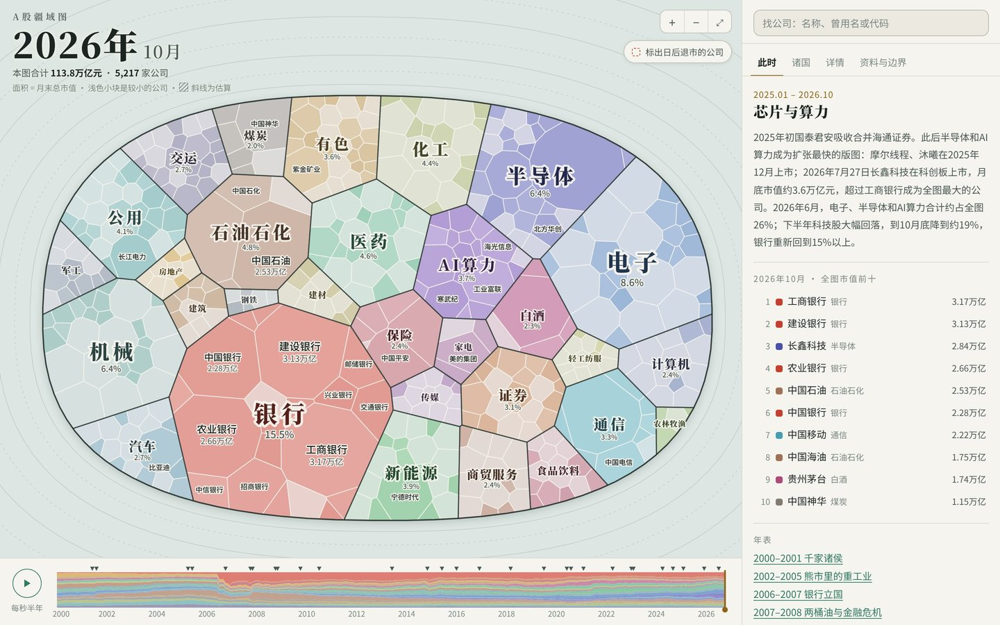

# A股疆域图

一张会动的A股地图：每个行业是一个国家，每家公司是一座城，城的面积就是公司的市值。拖动时间轴，看2000年到2026年沪深两市的行业版图怎么扩张、收缩。

**在线体验 · 地图：** https://wanglu2016.github.io/agu-jiangyu/
**在线体验 · 观潮（从地图里读出的六条规律）：** https://wanglu2016.github.io/agu-jiangyu/guanchao.html
**在线体验 · 发现好公司（从学科、产业、公司、价格筛四遍）：** https://wanglu2016.github.io/agu-jiangyu/faxian.html
**使用讲解视频（4分38秒）：** https://wanglu2016.github.io/agu-jiangyu/video.html （录制于加入候选国、海平面、“观潮”和“发现好公司”之前）




## 能做什么

- **看版图：** 30个行业各有固定颜色，国名下面是该行业占全图的份额；大公司单独成城，标着名字和市值，浅色小块是其余较小的公司。滚轮或双指可以放大。
- **拖动时间轴：** 2000年1月到2026年10月，每月一帧，共322个月。时间轴本身是一张按行业分层的年表，小三角标着大事；可以播放、调速。
- **此时：** 10段时代解说随年月切换，并列出当月市值前十的公司。
- **查一家公司：** 悬停看市值、全图排名和占比；点开看历年市值曲线和它先后属于哪个行业（例如中际旭创：机械 → 通信 → AI算力）。
- **搜索：** 名称、曾用名、代码都能搜，已退市的公司也在。
- **幸存者偏差：** 打开“标出日后退市的公司”，后来退市或被合并的公司会圈上红色虚线，并算出它们当时占全图多少。
- **诸国：** 30个行业各自的份额曲线，黑点标出每一国版图最大的时候。点开一国，可以看到它“最大两年后还剩多少”。
- **候选国：** 创新药、机器人、储能三个正在形成的行业，从2023年1月起用虚线国界画在地图上，公司从原来的国里划出；可以在“诸国”里一键隐去，回到原来的30国。
- **海平面：** 全图市值 ÷ 近一年GDP，也就是这片海的水位。地图标题、“此时”面板和时间轴（点“看海平面”）上都能看到，并给出历史上从相近水位出发后三年的情况。
- **时光机：** “此时”面板会告诉你，当月市值最大的十家公司到今天变成了多少，同期整张图又变成了多少。
- **年报：** 点开一家公司，“详情”里有它2010–2025年逐年的净资产收益率、最近一年的利润和市盈率，并可跳到“发现好公司”看完整的财报小传。
- **资料与边界：** 数据来源、算法和不准的地方。

## 观潮：六条规律

[观潮](https://wanglu2016.github.io/agu-jiangyu/guanchao.html)是同一份数据的第二个页面。地图让人看见版图，观潮把版图背后的规律一条一条算出来，每张图都可以拖动、切换。下面的数字按2026年10月的数据计算，页面上是实时算的。

| 章 | 说的是什么 | 图上的一个数字 |
|---|---|---|
| 水位 | 海平面越高，此后几年越难赚钱 | 2000年以来最低17%（2005年11月），最高142%（2007年12月），现在78% |
| 造陆 | 版图扩大多半靠新公司上市，而不是老公司涨价 | 全图市值是2000年初的36倍，名义GDP是16倍，只算老公司的市值是4.8倍 |
| 峰值 | 一个行业版图最大的时候，往往就是它最贵的时候 | 19个行业到顶两年后，份额平均只剩峰值的68% |
| 巨头 | 当年市值最大的十家公司，后来多半走得比整张图慢 | 2007年10月的前十占全图46%，到今天市值合计是当时的0.89倍，整张图是3.25倍 |
| 少数 | 多数公司原地踏步，少数公司带来了几乎全部增量 | 2010年底至今，中位数公司的市值只变成1.38倍，34%的公司比当时还小 |
| 国界 | 国界是人画的，新的行业正在形成 | 三个候选国、低空观察名单，以及科技行业内部六个环节的份额变化 |

这些都是历史统计，不代表未来，**不构成投资建议**。

## 发现好公司：从上往下筛四遍

[发现好公司](https://wanglu2016.github.io/agu-jiangyu/faxian.html)是第三个页面。地图让人看见版图，观潮讲的是不要做什么，这一页讲的是把注意力放在哪里：一个要选专业的学生、一笔要找去处的钱、一个什么都读过的AI，都只能把注意力不平均地分。它在市值之外加了两份数据：每家公司2010–2025年的年报（营收、归母净利润、归母净资产、经营现金流），和含分红的复权回报。下面的数字按2026年10月的数据计算，页面上是实时算的。

| 章 | 筛的是什么 | 图上的一个数字 |
|---|---|---|
| 源头（学科） | 版图往哪里长，先看知识往哪里流 | 研发强度5%以上的7个国，2005年底合计占全图13%，现在占33%；另有七条前沿和一片“远方”的卡片 |
| 沃土（产业） | 研发最多的土壤，不一定最肥 | 2016–2025年合计的净资产收益率：白酒26%、家电20%，计算机3%、半导体6%；全图从2010年的16%降到2025年的8% |
| 城基（公司） | 时间一长，股票的回报就是这门生意的回报 | 2015年底买入：此后十年净资产收益率超过20%的公司，持股回报的中位数是2.34倍；不到5%的公司占一半，中位数是0.44倍 |
| 地价（价格） | 好公司买贵了，一样不赚钱 | 2020年底“回报率15%以上、市盈率40倍以上”的88家公司，持有五年的年化回报中位数是−6.1% |
| 寻城（筛选） | 把四道筛子叠起来，自己改条件 | 5,217家 → 上市满十年且年报齐全2,452家 → 十年平均净资产收益率不低于15%的196家 → 默认条件下通过74家 |
| 分配（注意力） | 平均分配注意力，大半是浪费 | 白酒只有19家公司，占家数的0.4%，却出了5.6%的“十年一直赚钱”的公司 |

“寻城”里可以拖动条件、按国家或前沿筛选、直接搜一家公司；点一家公司会出现它的财报小传（逐年的净资产收益率、利润与现金流、年末市盈率）和一份体检清单，并可以跳回地图上看这座城。

前沿卡片里的判断、“AI的注意力”和“三类地”的分法是 AI（Claude）写的，会错，也会过时；筛出来的名单只是“过去十年像一家好公司、今天的价格不比它自己的历史贵”，是研究的起点，**不构成投资建议**。

## 下载

- **离线版网页（6.4 MB）：** [agu-jiangyu-site.zip](https://github.com/wanglu2016/agu-jiangyu/raw/main/download/agu-jiangyu-site.zip)。解压后双击 `index.html`（地图）、`guanchao.html`（观潮）或 `faxian.html`（发现好公司）即可使用，不需要联网或安装任何软件。
- **讲解视频（46 MB）：** [agu-jiangyu-guide.mp4](https://github.com/wanglu2016/agu-jiangyu/raw/main/video/agu-jiangyu-guide.mp4)，也可以在[视频页](https://wanglu2016.github.io/agu-jiangyu/video.html)点“下载视频”。
- **全部源代码：** 页面右上角绿色的 **Code → Download ZIP**。

需要较新的 Chrome、Edge、Safari 或 Firefox。手机也可以使用。

## 读图须知

- **口径：** 市值 = 月末收盘价 × 总股本。总股本按行情软件的通行口径，包含H股等境外股份并按A股价格折算，所以工商银行、中国石油这类A+H公司的版图偏大，“本图合计”通常比交易所公布的A股市值高一成左右。
- **估算：** 332家公司部分月份缺总股本，2010年以后用流通股本代替，2010年以前由成交额推算，图上画斜线。估算部分在2000年约占全图13%，2020年后不到1.5%。
- **行业：** 以证监会行业分类（2012年版）为基础合并成30个“国”；白酒、家电、半导体、AI算力（2023年1月起）是本项目按公司名单划出的。
- **候选国：** 创新药、机器人、储能的公司名单，以及“观潮”里的低空观察名单和科技环节分组，都是本项目按主营业务人工挑选的，边界有主观成分。峰值等统计一律按原来的30国计算。
- **海平面：** 全图合计市值 ÷ 近一年名义GDP（年度GDP在月份之间线性插值）。因为“本图合计”比交易所口径高一成左右，海平面也相应偏高。2015年起的GDP用第五次全国经济普查后的修订数；2014年及以前没有取到修订后的逐年数字，按2015年的修订幅度（+1.98%）接续，误差约1%；2026年按前三季度累计推算。“常见区间60%–80%”是经验区间，不是买卖信号。
- **老公司的市值（地价指数）：** 每个月只比较前后都在图上的公司，再逐月连乘。它不含分红，却包含增发和资产注入带来的市值，适合看长期方向，不宜当作收益率。
- **名称：** 多数公司用现名或退市前的最后名称，约三十家知名公司按改名时间显示旧名。
- **年报与净资产收益率：** “发现好公司”用的年报从2010年报到2025年报，所以“十年”指2016–2025财年；今天的市盈率是2026年10月末的市值除以2025年的归母净利润，没有用2026年的季报。净资产收益率 = 归母净利润 ÷ 年初与年末归母净资产的平均数。约一半公司的2025年现金流量表和研发费用没有取到；上市前的年份来自招股书，只画在公司小传里，不参与筛选。
- **持股回报：** 用复权收盘价计算，等于把分红再买成股票，只在每年12月末和最后一个月取值；它和“市值变成了几倍”不是一回事，后者还包含增发和资产注入。“城基”一章只统计今天还在图上的公司，回报率低的那几档实际更差。
- **学科与前沿：** 前沿的公司名单沿用候选国、观察名单和科技环节分组，学科与政策节点按公开报道的日期标注；高校专业数字来自教育部历年公布的本科专业备案和审批结果及公开报道，国家统计局的研发强度来自《2025年全国科技经费投入统计公报》。
- **没有收录：** 1990–1999年（只有文字序章）、北京证券交易所、B股、2026年9月18日之后上市的6家新股。
- 单家公司个别月份的数值可能有误。本项目适合看行业大势，不宜当作个股数据来源，**不构成投资建议**。时代解说由 AI（Claude）编写，可能有错漏，欢迎在 Issues 中指出。

## 数据来源与许可

| 内容 | 来源 | 许可 |
|---|---|---|
| 每日价格（含已退市公司） | [chenditc/investment_data](https://github.com/chenditc/investment_data)（整合 Wind、Tushare 等来源的 qlib 数据包） | Apache-2.0 |
| 总市值、总股本 | [L2Wscorpio/ashare-market-data](https://github.com/L2Wscorpio/ashare-market-data) | 仓库未注明许可 |
| 三大报表（2010–2025年报）、研发费用 | [L2Wscorpio/ashare-market-data](https://github.com/L2Wscorpio/ashare-market-data) 的财务报表 | 仓库未注明许可 |
| 复权价（含分红的持股回报） | [chenditc/investment_data](https://github.com/chenditc/investment_data) | Apache-2.0 |
| 流通股本、逐月证监会行业、公司名称 | [noblechang/a-share-data](https://github.com/noblechang/a-share-data)（BaoStock 数据快照） | 仓库未注明许可，声明仅用于学习与研究 |
| 名义GDP、分行业研发强度 | 国家统计局年度与季度数据、《2025年全国科技经费投入统计公报》 | 公开统计数据 |
| 高校本科专业新增数 | 教育部历年“普通高等学校本科专业备案和审批结果”及公开报道 | 公开信息 |
| 绘图库 | [d3](https://github.com/d3/d3)、[d3-weighted-voronoi](https://github.com/Kcnarf/d3-weighted-voronoi)、[d3-voronoi-map](https://github.com/Kcnarf/d3-voronoi-map) | ISC、BSD-3-Clause（见 `assets/lib/`） |
| 字体 | Noto Serif SC / Noto Sans SC，按本项目用字裁剪 | SIL OFL 1.1（见 `assets/fonts/OFL.txt`） |

本项目自己的代码与文字可自由使用；所用数据请遵守各来源的条款。

## 项目结构

```
index.html          地图页面
guanchao.html       “观潮”页面：六条规律
faxian.html         “发现好公司”页面：学科、产业、公司、价格四遍筛选（脚本在 assets/faxian.js）
video.html          讲解视频页
assets/             数据（data.js）、候选国版图（candidates.js）、GDP与名单（extra.js）、年报摘要与复权价（quality.js）、绘图库、字体、图标与截图
download/           离线版压缩包
video/              讲解视频
tools/              数据处理脚本，见 tools/README.md
```

本地运行：直接双击 `index.html`、`guanchao.html` 或 `faxian.html`；或在项目目录运行 `python3 -m http.server`，再打开 http://localhost:8000 。
